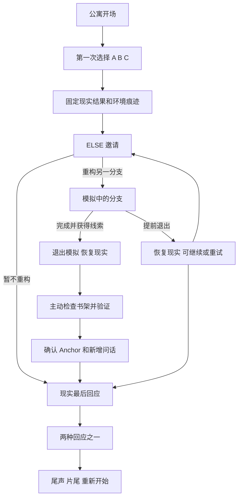

# Otherwise 小型完整游戏实施计划与里程碑

本轮目标是把现有公寓原型完成为一段可以独立体验、有明确结尾的故事。先完成从收到消息到最后一次现实选择的完整流程，再打磨演出和表现。保留当代都市、雨夜、林夏、ELSE 和知识跨越分支的核心，不增加城市关卡或人物群像。

2026-10-09 已按用户“全部完成，包括美术替换或者优化”的授权实施默认方向：林夏明早离开城市，今晚来告别；沿用并优化 2D 插画公寓。对白落在 `scripts/story.gd`，技术与美术实现均已接入。以下设计预算保留供真人试玩核对，不把预算当成实测结果。

## 完成目标与范围

| 项目 | 本轮目标 |
| --- | --- |
| 体验长度 | 标准首轮暂按 20–30 分钟设计；脚本节拍预算约 22 分钟，以新玩家实测为准，不用重复点击或长等待补时长 |
| 空间 | 一个公寓舞台；门外和下楼使用有限构图、声音与短转场，不建立可探索城市关卡 |
| 人物 | 主角与林夏；关系草案为曾经亲密、如今疏远的人，具体关系称谓在 M4 定稿 |
| 内容 | 三条短开场分支、一次可选重构、一个可验证异常、一个 Anchor、两种最后回应 |
| 主流程 | 开场选择 → 现实分支 → ELSE → 另一种可能 → 退出模拟 → 现实验证 → 最后回应 → 尾声与片尾 |
| 简短流程 | 拒绝重构后，仍能在现实里作出最后回应并看到完整普通结尾；不强迫玩家使用 ELSE |
| 重玩 | 从片尾重新开始完整故事；本轮不要求任意跳转、章节选择或无限重构 |
| 基础交付 | Windows 可运行包、操作说明、已知限制、版本与校验信息 |
| Linux 验证 | 仅在明确加入 Linux 目标后，使用独立 WSL ext4 检出验证；当前 Windows 小成品不以 Linux 验证为完成门槛 |

完成的含义是关系问题得到回应，玩家知道自己的最后决定；ELSE 的本体可以保持未解。片尾必须明确出现，不能停在可以无限重复点击的房间里。

## 剧情草案

### 核心冲突

林夏明早离开这座城市。今晚来找主角，不是要求主角改变她的决定，而是不希望两个人把最后的话继续留到明天。主角最初将这次来访理解成“要不要下楼”“要不要让她进门”，后来才意识到真正的问题是：是否愿意认真回应这段关系。

离开的具体原因无需再开一条支线。林夏已作出自己的决定；游戏不把她当成需要被玩家劝回来的奖励。最后两种回应都可以诚实、有代价，界面不评判好坏。

### 七个节拍

| 节拍 | 玩家行动与演出 | 提供的信息 | 预算 |
| --- | --- | --- | --- |
| 1 回到家 | 自由观察照片、电脑、信；手机短促震动与亮屏 | 房间属于一个普通人；照片显示过去亲密，信只是普通生活痕迹 | 3 分钟 |
| 2 楼下的消息 | 查看“林夏：我在你楼下。”；作出三选一 | 选择发生在信息不足时，没有明显正确答案 | 1 分钟 |
| 3 第一种现实 | 玩完一个短分支，观察其留下的痕迹 | 来访与明天有关；当前现实结果固定 | 4 分钟 |
| 4 ELSE 的邀请 | 电脑轻微唤醒；查看数据范围和概率重构说明；重构或退出 | ELSE 是主角的离线个人实验，模拟不等于事实 | 2 分钟 |
| 5 另一种可能 | 体验一个未选分支；听见书架线索；可以主动结束重构 | 另一条分支补充情绪侧面，出现具体、此前未提供给 ELSE 的信息 | 4 分钟 |
| 6 回到真实房间 | 确认原分支痕迹仍在；检查书架隐藏位置 | 那件东西原来就在现实里；模拟没有把物品带回来 | 3 分钟 |
| 7 最后的回应 | 用新理解发起最后通话或门口对话，选择是否陪她送站；明确结束 | 不改变过去的选择，但可以改变接下来如何回应；关系得到收尾 | 5 分钟 |

以上时间为内容设计预算，不是当前项目已达到的时长。对话均由玩家推进，玩家可快读；增加内容必须有新的信息或情绪变化。

### 三个开场分支

三个分支共用“林夏明早要走”的现实背景；不同的是玩家当晚得到的信息、两人距离与房间痕迹。不要写成三个互相矛盾的真相，也不要做三套独立结局。

| 分支 | 可玩的短场景 | 揭示的侧面 | 现实痕迹与回访 | 接入最后回应 |
| --- | --- | --- | --- | --- |
| A 下楼 | 主角走到门前确认出门；短转场到门外／单元门口的有限构图；两段对话后回公寓 | 她问能否明早陪她去车站，却避开为什么今天才开口 | 门边一把收拢的伞，可检查；手机保留请求 | 尚未答复的送站请求，不默认替玩家答应 |
| B 回复让她上来 | 林夏从门口到沙发边；玩家倒水并进行两段短对话 | 她已经决定离开，却不知道怎样把告别说完整；手机扣着表现迟疑 | 湿伞、另一双鞋、第二个杯子；全部可见，关键痕迹可检查 | 她临走说“明天的事，你想好了再告诉我”，不留 NPC 永久等在房间 |
| C 不回复 | 玩家明确选择沉默；用短时间转场代替真实等待；听见脚步离开，检查门边字条 | 她担心的不只是被拒绝，而是又一次没有说完；字条可读到明早离开的信息 | 湿字条可检查；手机显示消息状态 | 当晚仍能主动联系，不把时间推进到天亮导致最后回应失效 |

已实施的对白方向：A 保留“明天……你能陪我去车站吗？”；B 保留扣住的手机和雨气；C 的字条补足告别背景，但不直接替玩家总结心理。正式对白已在 `scripts/story.gd` 定稿并实现。

### 单一异常与现实验证

本轮只保留一个承担核心悬念的异常：书架下层旧书背后的一枚发圈。信降为普通生活线索，移除“看见桌上的信就证明 ELSE 不可能知道”的惊悚确认。雨和照片不再同时承担独立谜题。

模拟中的林夏指出具体位置，并提到发圈的一处蓝线修补。三个模拟分支都能提供这条线索，措辞按场景不同：当面提到、回复消息提到，或字条中提到。第一次真实分支不透露位置，避免必须“第二次重构再选回复”才能完成故事。

在第一次打开 ELSE 时，玩家能查看它实际使用的有限资料：近期已导入的消息、日历与主角提供的文字笔记；明确没有实时摄像头、房间扫描或书架内容记录。所有可查看资料都不包含位置、发圈或蓝线修补。原有资料来源中的照片、设备历史等泛化说明需同步收窄，避免自相矛盾。该信息是角色对数据范围的理解，不声称排除了所有可能解释。

发圈在现实初始状态就存在于遮蔽位置。首次普通检查书架只看见书脊；获得线索后才开放“检查旧书后面”的具体动作。退出模拟恢复原现实分支，玩家亲手找到发圈并看见修补细节。不得通过模拟台词让发圈突然生成，也不得在玩家检查前将 `found` 标为真。

短暂重复的雨声或一条重复雨丝只作辅助异常，退出模拟后恢复；不用全屏蓝色滤镜或说明“时间线不同”的大提示。

### Anchor 与最后选择

Anchor 的草案含义保留“她是在害怕明天”，但获得条件改为玩家完成另一种可能、验证现实线索，并通过一次主角思考确认对关系的理解。无需收集三条分支，不能靠分支数量自动发奖。

Anchor 在现实最后回应中开放一句新的问话，例如“明天离开之前，你还想和我说什么？”林夏的回应使其情绪含义成立。它改变能说什么、如何理解对方，不把任何模拟道具留到现实，也不自动替玩家作出最终承诺。

| 最后回应 | 关系收尾草案 | 演出与结束 |
| --- | --- | --- |
| 答应明早送她 | 主角明确承诺时间；林夏接受。承诺是陪她离开，不是让她留下 | 手机上确认约定；主角把伞放在门边；天将亮的短尾声后片尾 |
| 坦白不能送她 | 主角明确说出无法陪同，同时认真把今晚的对话说完；林夏得到一个清楚答复 | 一段不带惩罚语气的告别；主角收起手机；同样有尾声和片尾 |

拒绝重构的路线也保留这两个现实回应，但没有书架验证、Anchor 问话或异常尾声。完成重构的路线在关系收尾后可留下一个克制的 ELSE 画面，保持悬念，不在片尾引入新人物、新关卡或强迫续作。

## 状态与分支规则

采用当前小状态机能表达的有限流程。只在需要时拆出公寓表现、叙事控制、界面三个职责；不制作通用叙事引擎。

| 状态内容 | 生命周期与限制 |
| --- | --- |
| `reality_choice` | 第一次选择确认后固定，只能重新开始整局才清空 |
| 现实分支进度 | 原分支的对话、消息与痕迹保持；重构不会倒退现实钟表或替换现实人物位置 |
| `mode` | 显式区分 REALITY 与 RECONSTRUCTION；ELSE、对话、结束另有有限界面阶段 |
| `simulation_choice` | 临时分支，只影响模拟环境与对话；退出后清空 |
| `simulation_completed` | 成功玩完一次另一分支后结束本轮重构任务；不要求无限重试；未完成可以重试 |
| `seen_events` | 去重记录真正读到／检查过的事件；读取对白字符串不得改变它 |
| `shelf_hint_known` | 模拟中明确读到线索后保留到现实 |
| `hair_tie_verified` | 只由现实中的主动检查设置；物品本身始终属于现实基线 |
| `anchors` | 只保留本轮批准的一个知识标记 |
| `final_response` 与结束状态 | 最后选择提交一次；片尾显示后不能继续触发旧交互 |
| 重新开始 | 清除所有本轮状态、临时节点与音频；回到初始现实，不残留旧 Anchor |

检查时同时覆盖界面和输入：完成首选后手机不能重选；模拟中退出、ESC、取消均不能更改现实结果；重复按键不得重复获得 Anchor 或重复提交最后回应。

## 里程碑与验收

历史 M0–M3 保留原编号，但当前审阅发现的缺陷意味着不能把它们的完成标记当成本轮验收证据。本轮从 M4 开始，每个里程碑独立提交可审阅结果；有缺陷时修复当前里程碑，不跳到下一层扩大范围。

### M4 剧本与制作范围定稿

依赖：当前规划。产物：一个正式短剧本、三分支事件表、两种最后回应、异常信息与数据来源表、2D 或 3D 路线决定。

- Game Director 定稿来访目的、关系称谓、最终选择和异常内容；草稿不得默认为已经批准。
- 把七个节拍展开为可实现对白、玩家动作与停顿；每句有明确出现条件。
- 确认下楼如何用有限构图呈现，先用占位画面即可。
- 确认三分支都能接入相同终章；拒绝和提前退出重构也有出口。
- 选定表现形式后再同步 GAME_VISION、README 和旧 M3 的历史状态说明。

验收：纸面走完三个开场到两个结尾，所有情绪结论有文本或行动支撑；没有需要新关卡、新人物才能兑现的剧情；能列出本轮每项资源。

### M5 修复公寓基础与交互

依赖：M4 的表现形式。产物：可靠的可移动公寓、可读且可检查的关键物件、真实移动验收。

- 修通门口；按家具落地轮廓而非整张立面校准碰撞，避免床和后墙形成不可通行夹缝。
- 修正桌面道具与家具遮挡排序，确保第二杯和信封可见。
- 统一舞台、视口、背景填充与 UI 坐标，消除灰边。
- 确保手机、门、电脑、照片、信、书架全部能正常接近；关键分支痕迹增加简短检查。
- 移动切到实际位移驱动步态；顶住家具时不原地踏步，交互时冻结与恢复一致。
- 用输入动作统一操作，支持 WASD、方向键和交互键；点击移动先保留为可选项。

验收：从出生点连续移动到全部六个核心交互物并操作，不用瞬移；三个分支痕迹可见；角色不穿家具、不漏到舞台外；截图目标与当前交互物一致。

### M6 现实与模拟状态闭环

依赖：M5。产物：开场选择锁定、一次重构、退出恢复、知识保留与干净重开。

- 固定现实选择，手机改为查看现有消息。
- 在进入模拟前保留有限现实状态，退出时恢复相同分支与道具，不修改现实结果。
- 提供明确的开始、暂不、提前退出和完成返回；系统文字说明模拟属性，场景仍保持相似。
- 用具体事件控制线索与 Anchor；移除对白取值函数修改状态的副作用。
- 发圈始终在现实遮蔽位置，检查前不算发现。
- 验证重新开始、连续按键、取消、暂停与重构转场期间的输入保护。

验收：从 A、B、C 任一现实分支模拟另外任一分支，共六种顺序，返回后现实痕迹完全一致；提前退出不授予未读知识；重开没有残留。

### M7 从开场到片尾的完整剧情

依赖：M4、M6。产物：可用占位角色和画面完整玩通的小故事。

- 实现七个节拍、三段短分支、书架验证、Anchor 问话、两个最后回应与片尾。
- 手机震动与电脑唤醒引导下一步；引导依赖当前进度，不出现过时提示。
- C 分支维持同一晚，保证最后联系仍合理。
- 主流程只需一次成功重构；无需看遍三分支或按固定顺序选两次回复。
- 暂不重构与提前退出都有自然的现实收尾。
- 重要观察和对白由玩家推进，避免长文本固定 3.5 秒消失。

验收：六条不重构的首选／最后回应组合、十二条另一分支重构／最后回应组合都能到达正确片尾；额外覆盖提前退出与重试。剧情台词已定稿，无“以后补”的关键结尾。

M7 完成后才允许投入完整美术替换。若此时故事不成立，优先修改节拍和对白。

### M8 人物演出与环境叙事

依赖：M7。产物：房间里的事件与关系可以被玩家看见。

- 用少量主角和林夏姿态、门口／沙发／窗边站位与停顿替换连续黑屏说明。
- A 的短转场表达下楼与返回，B 真正表现入门和倒水，C 表现脚步离开与字条。
- 统一人物、书架、鞋、伞、杯子、信的线条、尺度、透视与接触阴影。
- 补足照片可辨内容和主角背面走路帧，保持镜像与脚底对齐。
- 保持发圈在全景中细小；主动检查后用局部画面看清，不靠巨大高亮破坏发现感。
- 雨丝限制在窗玻璃内；模拟最多增加一个短暂异常，退出后恢复。

验收：玩家能从房间判断当前分支痕迹；每段关键对白有角色、动作或物件对应；不依靠大段旁白才能知道发生了什么；无明显漂浮、遮挡或画风冲突。

### M9 声音与可读性打磨

依赖：M8。产物：完成声音、界面、基础设置和性能检查。

- 增加雨声、手机震动、脚步、门和电脑的必要声音；重构异常使用克制的重复／停顿。
- 提供总音量、静音与文字大小设置，暂停时不推进剧情或雨声异常计时。
- 选项支持键盘与点击、明确焦点；观察与对话有清晰关闭／继续操作。
- 普通 HUD 克制；对比度和字幕底衬保证读得清楚，提示尽量靠近对象。
- ELSE 显示有限的数据范围与已知事件，必要时最多六个静态节点；不制作图编辑器。
- 打包可用中文字体并核对字体与音效许可，避免依赖另一台机器的系统回退。
- 实测 X1 Lite 目标设备的启动、转场、帧时间与内存；依据观察修复，不提前优化架构。

验收：1280×720 与 1920×1080 下无截字、灰边或越界；静音与大字号均可完成；参考目标为 720p 常态稳定 60 FPS，未达标时记录实测并修复明显卡顿。目标不是已测结论，分支转场与反复重开必须一并检查。

### M10 完整试玩与交付

依赖：M9。产物：小型完整游戏发行候选版及可复核记录。

- 运行导入、启动、状态测试和渲染检查；截图脚本改为基于状态等待与断言，不把退出码 0 当作剧情通过。
- 运行完整路径矩阵，包括 ESC、暂不、重复选择、提前退出、重试、片尾和重新开始。
- 完成目标机器的实际人工试玩；自动化证据不能替代情绪和可理解性验收。
- 邀请至少两名未读剧本的玩家试玩：一名从头体验重构主流程，一名优先尝试拒绝／取消路径；记录卡住位置、对现实／模拟的理解和真实时长。
- 若明确加入 Linux 目标，使用独立 WSL ext4 检出做原生验证；不在 `/mnt/d` 构建，不共享 `.git` 或直接同步工作目录。实施前核对本机 GameDev 共同规范，按 Git 交换提交；没有 Linux 目标则记录为不适用，不为此创建副本。
- 制作 Windows 运行包，验证解压后离线启动、中文字体、音频、结尾与重开；补齐资源许可、校验值、运行说明与已知限制。

验收：没有阻塞缺陷；所有必做项有实际证据；新玩家能说明林夏为什么来、自己最后决定了什么、何时离开模拟，以及异常为何值得怀疑；能够从发行包玩到片尾。

## 全部改进的任务清单

P0 表示完整故事必需或阻塞体验；P1 表示本轮成品质量必需；P2 表示可选，不阻止完成。下表是完整验收清单。I01–I25、I27、I30、I32–I34 已实现并有工程验证；I26 有字体／新音效／新美术来源记录，但既有美术权利声明仍缺历史材料；I28 需真人新玩家试玩；I29 仅有当前机器渲染采样，未等同长期性能验收；I31 当前不适用。

| ID | 改进 | 优先级 | 里程碑 | 通过条件 |
| --- | --- | --- | --- | --- |
| I01 | 来访目的、关系与两种最后回应 | P0 | M4 M7 | 三首选均可自然到达两个结尾 |
| I02 | 2D 与 3D 文档一致性 | P0 | M4 | 明确选择一种表现形式，规范不再冲突 |
| I03 | 门口通路与家具碰撞 | P0 | M5 | 不瞬移即可到门并交互 |
| I04 | 六个核心物件可达与提示准确 | P0 | M5 | 连续移动验收全部通过 |
| I05 | 杯子和信封绘制层级 | P0 | M5 | 正常场景中可见且不会破坏人物遮挡 |
| I06 | 舞台和视口统一 | P1 | M5 M9 | 目标分辨率无灰边或 UI 越界 |
| I07 | 首次选择固定 | P0 | M6 | 手机无法覆盖现实选择 |
| I08 | 现实基线与模拟退出 | P0 | M6 | 六种重构顺序均恢复原现实 |
| I09 | 事件显式写入与去重 | P0 | M6 | 读文本无状态副作用，重复输入不重复提交 |
| I10 | 发圈真实存在与主动验证 | P0 | M6 M7 | 不生成跨分支物品，检查前不授予发现 |
| I11 | ELSE 数据来源与概率说明 | P0 | M4 M7 | 已知资料不包含异常细节，不误称真实宇宙 |
| I12 | Anchor 来源与实际作用 | P0 | M7 | 证据支撑理解，开放一次现实新问话 |
| I13 | 三分支对白与有限演出 | P0 | M7 M8 | 每条都有新信息和玩家行动 |
| I14 | 取消重构与结尾出口 | P0 | M6 M7 | 暂不、提前退出不形成死路 |
| I15 | 片尾与干净重开 | P0 | M7 | 结尾明确，重开无状态残留 |
| I16 | 手机与电脑的进度引导 | P1 | M7 | 新玩家无需看说明找到下一步 |
| I17 | 关键痕迹检查与照片内容 | P1 | M5 M8 | 物件提供有用、不过度解释的信息 |
| I18 | 林夏姿态和主角步态 | P1 | M8 | 距离和姿态可读，背面不滑行 |
| I19 | 按实际位移动画与统一输入 | P1 | M5 | 顶墙不踏步，冻结后恢复一致 |
| I20 | 画风、投影与接地阴影 | P1 | M8 | 人物和新道具融入同一场景 |
| I21 | 雨丝裁剪与单一辅助异常 | P1 | M8 | 不画到墙外，退出模拟正常恢复 |
| I22 | 长文字推进、大字号与对比度 | P1 | M7 M9 | 不自动漏读，设置后无截字 |
| I23 | 可点击选项、焦点与暂停 | P1 | M9 | 键盘和鼠标均可完成，暂停不跳剧情 |
| I24 | 必要音效与音量控制 | P1 | M9 | 声音不叠漏，静音也可理解剧情 |
| I25 | 小范围职责拆分 | P1 | M6 | 状态所有者明确，只拆当前需要的职责 |
| I26 | 字体、音效与资产许可 | P1 | M9 M10 | 打包离线可用，许可清单完整 |
| I27 | 状态断言、渲染与真实移动验收 | P0 | M5 M6 M10 | 错目标、错状态和错文本能使验收失败 |
| I28 | 新玩家试玩与实际时长 | P0 | M10 | 完整体验到片尾，记录并解决主要困惑 |
| I29 | 性能实测与有证据的修复 | P1 | M9 | 参考设备无明显卡顿，记录实测数据 |
| I30 | 运行说明、Windows 包与校验 | P0 | M10 | 解压运行包即可从开场到片尾 |
| I31 | 独立 WSL 原生验证 | P2 | M10 仅限 Linux 目标 | 确需时使用原生 ext4 检出；无目标记录为不适用 |
| I32 | 点击移动 | P2 | M5 后评估 | 仅在现有移动稳定且实现稳健时加入 |
| I33 | ELSE 静态因果小图 | P2 | M9 后评估 | 仅表示已知／推测／未知，不遮挡阅读 |
| I34 | 中途保存和继续 | P2 | 完成后评估 | 已加入现实关键节点自动存档、手动存档和标题继续；模拟不保存 |

## 资源清单与实施边界

沿用现有背景和大部分道具。必要新增或修订：林夏三个基础姿态、主角背面两张步态帧、可辨照片、发圈检查局部图、下楼短构图或占位画面、片尾画面、必要音效和可分发中文字体。新增资产先占位，M7 后再完成正式版本。

五项新美术已生成、检查并接入，见 ART_DIRECTION.md；五种音效已原创合成、字体已打包。林夏不用完整八方向行走、配音或面部动画。门外不用可探索地图。信不用再做一个异常系统。分支痕迹使用现有鞋、伞、杯子与字条，避免只为“丰富”加入无叙事作用的杂物。

暂不实现：通用时间线编辑器、联网 LLM、真实个人数据集成、物品跨世界搬运、好感度、战斗、开放城市、复杂存档、全配音和写实人物。3D 路线只在 M4 明确选定后重新规划，不作为中途解决美术问题的默认手段。

## 验证矩阵与完成门槛

| 路径 | 数量 | 必查内容 |
| --- | --- | --- |
| 不重构到结尾 | 3 首选 × 2 最后回应 = 6 | 原分支固定、自然收尾、没有异常／Anchor 误触发 |
| 重构另一分支到结尾 | 3 首选 × 2 其他分支 × 2 最后回应 = 12 | 线索可获得、现实恢复、主动验证、Anchor 问话、正确片尾 |
| 模拟提前退出并重试 | 至少每个现实分支各 1 条 | 无知识提前授予、可重试、无重复节点和声音 |
| 模拟提前退出后直接结束 | 至少每个现实分支各 1 条 | 普通结尾仍可完成，不把未验证线索当事实 |
| 取消与重复输入 | 每种界面 | ESC 不绕过锁定，重复提交无副作用 |
| 片尾与重新开始 | 普通／异常流程各测两个回应 | 结束后无旧交互，重开完整清理 |
| 画面与声音 | 两个目标分辨率，大字号，静音 | 无截字、灰边、遮挡、雨丝越界或音频残留 |
| 发行包与平台 | Windows 必须；WSL 仅限明确的 Linux 目标 | 离线启动、字体与资源加载、完整流程 |

正式交付同时满足：18 条基本结尾路径通过；没有阻塞缺陷；人工完整试玩通过；Game Director 接受剧情和情绪效果；Windows 发行包通过解压后试玩。单纯导入通过、脚本退出码 0 或生成截图，都不足以证明完成。

## 当前状态与验收记录

| 里程碑 | 当前状态 | 实际证据／剩余门槛 |
| --- | --- | --- |
| M4 剧情定稿 | 实现完成 | 三个开场、可选重构、证据检查、Anchor 新问话、两种尾声；2D 和输入资料范围已同步规范 |
| M5 空间与交互 | 自动验收通过 | 六核心物件真实移动到达；门口可达；杯子／信封可见；WASD、寻路、键鼠输入分发通过 |
| M6 现实与模拟 | 自动验收通过 | 18 基本路线；三种中断普通出口／重试；首次选择固定，暂停和重开，无未读知识提前授予 |
| M7 完整故事 | 实现与状态验收完成 | 普通／异常流程都到片尾；情绪、理解与时长需真人验收 |
| M8 美术演出 | 静态渲染复核通过 | 五项新资产、三姿态、背面步态、物件层级、接地阴影、雨丝裁剪、发圈特写；美术角色只读复核通过 |
| M9 UI 声音与性能 | 工程检查完成，听感待试玩 | 中文字体、手动推进、大字号、焦点、音量、暂停、六节点图；声音 Dummy 驱动加载；当前机器有帧间隔采样 |
| M10 打包与交付 | 本地发行候选包 | Windows 包、校验与开发／包内资源验证；原生窗口授权超时，真人完整试玩及两名新玩家反馈待完成 |

详细命令、结果和限制见 QA_REPORT.md。未公开发布、未远程推送、未建立 Linux 副本。开发测试和截图脚本被排除出发行 PCK。

这轮修复了原审阅发现的门不可达、首次选择重选漏洞、跨分支物理状态、未验证 Anchor、遮挡道具和不可信截图脚本。输入回归还发现并修复片尾数字键无法重开，以及键盘顶墙后点击寻路失效。电话阶段不会错误地生成房间中的林夏。

下一道门槛是从 ZIP 解压后的实际真人完整试玩：确认林夏来访目的、现实／模拟边界、异常线索和两个最后回应是否清楚，记录真实时长与声音听感。工程已交付可运行成品；这些人类验收项仍标记未验证，不以自动检查替代。
